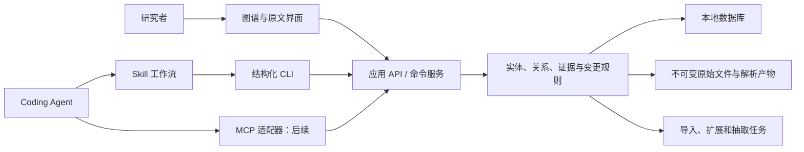

# Show Me Graph 项目任务书 v0.7

日期：2026-10-05 
状态：需求尚未冻结；用户已授权启动 M0，局部验证原型已运行，正式产品未实现。 
目标用户：调研 AI 研究课题的博士生及其他研究人员。 
首个试点：图像生成，以 Qwen-Image-2.0 技术报告及其官方资料为锚点。

本次修订：根据原型反馈，顶部改为引用关系的树状分层布局，技术切面在总览中侧向竖立；左右栏支持展开/恢复，增加明亮/夜间主题。M0进度见 [实测结果](M0_RESULTS.md)。两种调查模式、完整 API 与 Skill 仍是后续交付目标。

## 1. 项目定义与成功标准

构建一个**以原文证据为基础、允许人类与 Coding Agent 共同维护的本地研究知识图谱**。用户输入论文、参考文献、研究主题或阅读中的具体疑问后，系统组织文献，抽取知识实体及其关系，并形成可回到原文的解释。三维空间由顶部论文关系平面、每篇论文下悬的完整二维技术图，以及这些图之间的连线组成。

核心价值是让研究者能够回答：

1. 这个研究方向有哪些相关论文，哪些已读，哪些尚未获得全文？
2. 一篇论文提出了什么方法、系统、组件或结论？它实际使用了哪些已有工作？
3. 一个方法经历了哪些变体与扩展？这些判断的原文依据是什么？
4. 当我只关注某个问题、分组或标签时，如何得到可保存、可修改的局部图谱？
5. 能否让 Coding Agent 完成与人类界面等价的知识库维护工作？
6. 阅读时遇到一个术语、公式或表格设置，能否直接得到清楚的解释，并让背后的相关文献调研成为可复用知识，避免下次从头查起？

首版成功意味着：围绕一个实际研究问题，完成“导入 → 抽取 → 自动入图 → 三维总览与切面浏览 → 原文核对 → 修正 → 导出与恢复”的闭环，并能够从一个具体疑问出发扩展知识图谱、给出带来源的解释。节点数量与三维效果不能单独作为成功指标，但完整三维空间本身是必要交付物，不能以二维图替代。

## 2. 已确认需求、建议默认值与边界

### 2.1 用户已确认

| 编号 | 需求 |
| --- | --- |
| U01 | 从提供的资料或参考文献出发，整理研究方向的文献，并形成独立本地知识库。 |
| U02 | 同时记录论文与论文、成果与成果，以及跨论文成果之间的关系。 |
| U03 | 知识包括论文提出或使用的模型、方法、系统、组件、实现、结论，以及理解它们所需的概念与定义；类型应可扩展。 |
| U04 | 必须提供三维总览：顶部为论文关系横切面，每篇论文下方悬挂一张完整二维技术关系纵切面，切面间允许关联。 |
| U05 | 论文支持分组和选择，只查看选定论文及其相关子图。 |
| U06 | 节点支持备注、标签与检索筛选。 |
| U07 | 成果节点链接到本地论文的具体段落，保障可核查性。 |
| U08 | 所有人类可操作的功能都提供对应的程序接口，允许 Agent 代为维护。 |
| U09 | 提供 Skill 接入 Coding Agent；以跨客户端复用为目标。 |
| U10 | AI 抽取内容默认自动进入主图，持续标明 AI 推断和证据状态；不要求逐条人工审批后才显示。 |
| U11 | 第一批真实试点为图像生成，锚点为 Qwen-Image-2.0 的技术资料。 |
| U12 | 支持单独查看顶部论文横切面、任一论文技术纵切面，以及跨论文系统/方法关系的技术横切面；各视图共享知识身份。 |
| U13 | 每张论文技术切面包括本篇提出、采用和讨论的相关知识，允许一般图和孤立节点，不要求连通，不强制组织成树。 |
| U14 | 支持从阅读中的小问题追溯定义、来源、作用、适用条件与历史问题，自动调研后给出解释，并把结果保存在知识图谱中。 |
| U15 | 提供极速和深度两种模式：极速围绕当前问题按需查阅；深度主动完成选定论文、论文集合或课题范围的系统调查，不等待逐点提问。 |
| U16 | 用户现有文献管理工具主要为 Zotero；产品应接入这一工作流，避免要求重新整理已有文献。 |
| U17 | Agent 调研发现的新论文自动收录到用户指定的 Zotero 分类目录，配置目标后无需逐篇确认。 |

### 2.2 建议默认值，后续可调整

- 首版为单人、本地优先的服务与浏览器界面，先在当前 macOS 环境验证；数据格式保持跨平台可迁移。
- 先围绕锚点建立 30–50 篇论文的可用图谱，再扩大研究范围。
- 检索和处理预算按模式、研究范围配置。极速以回答当前问题为停止依据；深度以调查计划及覆盖情况为依据，不套用统一的 2 跳等固定上限来声称调查完整。可设置数量、用量或时间预算，触及预算时保留进度并明确未完成。
- 顶部论文平面位于 `z=0`；每篇论文拥有独立局部二维布局，再嵌入其下方的垂直平面。坐标只负责摆放，不固定表达类型、组件深度或技术优劣。切面的方位、间距与避让策略由原型验证。
- 原文明确陈述、AI 推断、用户判断可以同时存在；未经核验的条目默认可见。
- 抽取首先复用宿主 Coding Agent 的阅读与推理能力，另设可选模型服务适配器；不默认要求用户再购买一个推理服务。
- 项目工作名使用当前目录名称 Show Me Graph。
- Zotero 作为主要文献入口，支持选择条目/目录导入、增量读取，以及向用户指定目录自动收录新论文；知识图谱保存在独立本地库。

### 2.3 范围界定

“整理整个领域”是长期目标。一次可执行任务必须给出研究问题、锚点、检索来源、时间范围、跳数或数量预算、纳入与排除条件。系统报告已覆盖范围和遗漏风险，不输出无法验证的“已收齐所有论文”。

第一版不包括模型训练或推理平台、多人实时协作、自动投稿、独立通用聊天产品、数学定理自动证明、百万节点实时渲染。阅读疑问的研究与解释通过宿主 Agent 和知识库接口完成，属于首版。扫描件可以明确降级为待 OCR 或仅可阅读，但不能生成假定位。三维总览与各类二维切面均属于首版；高级自由三维编辑不属于首版。

## 3. 核心使用流程

### 3.1 两种调研模式

两种模式使用同一知识库、证据规则和三维视图，区别是主动调查的范围与时机，不是允许的事实准确性不同。

| 项目 | 极速模式 `fast` | 深度模式 `deep` |
| --- | --- | --- |
| 输入 | 一个问题，可附论文、段落、公式、表格或图中节点。 | 单篇论文、选定论文集合或明确的研究课题及锚点。 |
| 执行方式 | 先复用本地知识，按回答缺口读取原文、查必要定义和来源；不自动调查所有相邻技术点。 | 自动制定并执行调查计划，逐项梳理重要技术点、概念、系统/方法、来源、相关路线、结论、证据和局限，自主追踪重要文献。 |
| 停止依据 | 已足以回答当前问题，或已明确说明现有资料无法解决的部分。 | 范围内的调查清单已执行，关键知识点及关系覆盖情况已检查；留下明确的争议、不可获取资料与未解决问题清单。 |
| 用户先看到什么 | 当前问题的清楚回答及证据入口；新知识同步入图。 | 持续形成的论文图与技术切面、调查进度；完成后交付系统解释、技术关系与覆盖报告。 |
| 图谱变化 | 累积本问题涉及的局部知识，逐步生长。 | 系统补齐选定范围的论文及技术关系图，复用已存成果。 |
| 不足与失败 | 证据不足明确说明；不以追求速度为由省略来源或编造定义。 | 预算耗尽、失败或中断明确标为未完成，不能算完整调查；保留剩余工作以便续跑。 |

深度调查启动后不要求用户逐个批准技术点或反复提出后续问题。系统从输入提取范围并记录为任务计划；只有范围无法合理确定时才需要澄清。“完整”指在该范围与检索方案内进行系统覆盖，不等于宣称穷尽整个领域。

模式按任务选择。极速产生的局部成果可直接作为深度任务起点；深度进行期间，用户仍可发起极速问题，读取已有结果或补充必要缺口，不自动取消深度任务。暂停、取消和恢复是独立操作，保留原任务进度。任务记录实际模式、范围、已处理项、待处理项、失败及用量信息。

深度任务建议交付：范围与检索记录、纳入/排除文献、本地资料及缺失项、论文及技术关系图、关键概念解释、方法比较与限制、证据状态、未解决问题，以及可继续扩展的入口。

### 场景 A：建立一个研究方向的知识库

1. 用户创建“图像生成”研究项目，输入 Qwen-Image-2.0 技术报告链接或本地 PDF，以及关注的问题。
2. 系统登记资料来源、规范化论文身份、保存原始文件；引用扩展任务记录检索式、来源、时间及预算。
3. 可获取全文的文献保存为不可变版本；无法获取的文献保留元数据与失败原因。
4. 解析器产生带页码和位置的文档块；Agent 抽取关键成果与有类型的关系。
5. 基础结构合法的内容自动进入主图，默认状态为“未核验”；引用位置另行检查，无证据或定位失效时明确标注，关系解释为推断时也明确标注。
6. 用户在三维总览查看论文平面、各论文下悬的技术切面及切面间关系，并能进入单独切面阅读。
7. 点击任意节点或关系的证据，打开对应版本的本地 PDF 并高亮原文。

### 场景 B：日常维护

用户或 Agent 可以新增文献、补证据、改名、合并重复实体、拆分错误实体、修改关系类型、做备注、打标签、调整分组和保存视图。所有变更记录操作者与原因；重新抽取不能静默覆盖用户修正或已核验条目。

例如：“给这些论文加上‘文字渲染’标签，保存一个只显示它们及其直接组件的视图，并把证据失效的关系列出来。”应能够完全通过 Skill 调用接口完成。

### 场景 C：从研究问题回到证据

研究者查询“哪些系统使用了某类条件编码器”，筛选出相关节点和关系，查看每条关系的陈述来源与证据状态，再定位原文。结果必须区别“论文明确写明使用”和“AI 根据架构描述推断使用”。

### 场景 D：从一个阅读疑问展开调研，再沉淀解释

用户的实际痛点是：某个激活函数、VAE 压缩率定义或一张对比表看似只需要一次简洁回答，但理解它需要追查多篇论文中的定义、设计动机、适用条件和历史局限。

1. 用户从段落、公式、表格或节点提问；系统保存问题、阅读上下文、目标论文版本及已知知识范围。
2. Agent 优先查询已有知识库，再按问题缺口读取原文和必要参考文献，避免每次重做完整调研。
3. 新资料先形成概念、定义、方法、结论及有证据的关系；“用于解释本问题”与“原论文确实采用”分开记录，不能把补充背景知识伪装成论文贡献。
4. 返回分层解释：直接回答、必要定义/公式、在当前论文中的作用、成立条件，以及可展开的技术来源与比较。不同来源有分歧时保留分歧。
5. 解释引用图中的断言与原文证据；相关论文进入顶部图，技术点进入对应论文切面，跨论文关系可追踪。问题记录用于再次检索，不默认挤入科研实体图。
6. 记录已解决、仍缺证据和预算内未完成的问题。极速模式按“足以回答当前问题”停止深入；深度模式将本问题结果回填调查清单后继续其他重要技术点。预算不足时返回现有证据与未完成项，不假报完成。

启动策略已确定为两种模式：极速按问题查阅，深度直接展开系统调查。两种方式写入同一知识库；单纯导入文件不自动等于启动深度调查。

覆盖状态与可信度状态分开：某知识点可以是“仅识别名称”“已找到定义”“已查来源”“已比较相关方法”或“仍有未解决问题”。尚未展开必须可见，不能把暂未调查表现成不存在相关文献；这些是调研进度，不是科学正确性等级。

### 场景 E：从 Zotero 开始调研

1. 用户或 Agent 选择 Zotero 条目、分类目录或标签范围，映射为研究项目/分组，不默认导入整个文献库。
2. 读取书目信息、目录、标签、笔记和 PDF 附件引用。保留多附件的各自身份与选用结果；附件未在本机可用时明确标注。笔记作为用户资料，不当作论文原文。
3. 对用于解析的 PDF 保留文件指纹和本地不可变证据快照，再执行极速或深度调研。
4. 再次读取时更新变化的来源记录与附件，保留已有图谱、解释及人工修正。
5. 论文节点提供返回 Zotero 条目的入口；段落级证据使用本应用的固定版本阅读器，避免附件更新后旧结论指向不同原文。

Zotero 继续管理现有书目和附件，本应用管理知识实体、关系、解释和三维视图。导入的标签/笔记记录来源，本应用新增内容分别保存。新论文自动收录已确定；既有标签、笔记和删除操作的全量双向同步不包含在这一决定内。

条目从目录移除或被删除时，更新来源状态及目录映射，不自动删除已保存知识和证据。Agent 新发现并纳入调研范围的文献同时进入本地知识库与自动收录流程；普通检索命中但未纳入的候选不批量写入 Zotero。

### 场景 F：自动收录到指定 Zotero 目录

1. 用户在项目设置中指定目标文献库和分类目录，任务可显式覆盖。保存库身份与 collection key，界面显示目录路径；这里的目录指 Zotero 分类集合，不是磁盘文件夹。
2. 极速和深度模式发现纳入调研的新论文时，自动登记并收录，无需逐篇审批。未配置目标时提示配置并暂存待收录项，不猜测目录。
3. 按 DOI、arXiv 等可靠标识在目标库去重；已存在则加入指定目录并保留原有目录归属，不重复建条目，不仅凭标题相似合并。版本区分沿用论文身份规则。
4. 能获取全文时关联 PDF；缺少全文时先收录元数据与来源链接，本应用记录全文待获取。后续补附件，不阻塞已有资料的调研。
5. 保存 Zotero 返回的条目/附件身份及收录状态。条目写入和附件写入分别记录，不能把仅有元数据显示成附件已保存。
6. 断连、目录失效、无写权限或写入失败时保留失败原因及队列；恢复后重试。超时后先核对已有结果，避免重复创建；只在确认写入后显示已收录。

目标配置、待收录列表、状态检查和失败重试均提供 UI 与 Agent API。应用不额外要求逐篇确认；连接所需的 Zotero 授权按实际客户端机制处理。目录失效时不自动改投其他目录。

## 4. 知识模型：实体、断言与证据

### 4.1 全图是有类型的知识图谱

采用允许多种边的有向多重图。**只有明确要求无环的关系子图采用 DAG 约束，不能对全部边强制无环。**

- 组成结构、具体版本之间的严格演进关系可施加无环约束。
- 引用、比较、使用、讨论、相似、支持与反驳可以在混合图中形成环。
- 同一组实体可存在不同关系；“引用”不能自动升级为“继承”。
- 发现环时报告关系类型、环路径与证据；不为满足布局而自动删边。
- 论文的继承视图可以从有证据的成果演进关系汇总，但汇总边必须标明“派生视图”，并能展开回到底层关系。
- 顶部默认提供用户要求的论文演进 DAG 切面；其边集由明确的演进关系及可追踪的汇总关系构成。引用/比较等其他边作为可切换关系视图保存；不能把可能有环的混合关系图无条件称为 DAG，不能为了得到 DAG 丢弃证据。
- 单篇论文纵切面是知识库的局部图视图，允许不连通节点、多重关系和符合关系语义的环；图的摆放方式不产生新的继承或组成事实。

### 4.2 最小对象模型

| 对象 | 用途与必要属性 |
| --- | --- |
| ResearchProject | 调研范围、锚点、检索预算、纳入规则、默认视图和自动化策略。 |
| Paper | 一项论文工作的稳定身份；标题、作者、年份、DOI/arXiv 等外部标识。 |
| PaperVersion | arXiv 修订版、会议版等具体版本；版本日期、标识、与 Paper 的归属。 |
| SourceArtifact | 原始 PDF、HTML 或补充材料；来源 URL、获取时间、相对路径、内容哈希、媒体类型。 |
| ExternalSourceRef | 外部来源映射；连接标识、库类型/ID、条目 key、附件 key、源修订号、目录与标签来源及可用状态。源条目修订号不等于论文发表版本。 |
| ParsedBlock | 原文段落、公式、图表等块；文档版本、解析器版本、页码、文本和位置。 |
| Entity | 科研知识实体；稳定 ID、类型、名称、别名、描述、必要的版本与限定条件。 |
| Assertion | 关于实体属性或关系的一项陈述；主语、谓词、宾语或值、条件、证据、来源与核验状态。 |
| Evidence | 绑定固定文件版本的原文证据及多重锚点；可被多个断言引用。 |
| Annotation / Tag | 对论文、成果、关系或证据的备注与标签；不自动构成学术事实。 |
| PaperEntityOccurrence | 一个实体在特定论文版本中的出现与作用（提出/使用/讨论/补充解释）；区分全局实体身份、论文语境及展示实例。 |
| Collection / SavedView | 论文分组；切面类型、成员选择规则、局部二维布局、三维嵌入位置及相机状态。 |
| ResearchQuestion / Explanation | 阅读问题、上下文、解释内容及引用的断言/证据、未解决项与生成修订；不要求作为普通图节点展示。 |
| Job / ChangeSet | 调研模式、范围、调查清单、覆盖/待处理项、任务状态与批量修改记录，支持暂停恢复、错误报告和回退。 |

实体类型初始包含 `model`、`method`、`system`、`component`、`implementation`、`claim`、`concept`、`definition`；`dataset` 和 `benchmark` 作为图像生成试点的扩展类型。定义需保留符号、单位、约定及适用语境，例如不同论文可能以不同口径使用“压缩率”。类型变化需要版本化的词表，不要求每篇论文都填满所有类型。

同一个方法可以被多篇论文提出、描述、使用或扩展。论文与成果不是独占父子关系。区分通用方法、该方法的具体变体、代码实现和模型版本；不能只因名称相同合并，也不能仅因名字变化就认定全新成果。

论文合并优先使用可靠外部标识和来源映射。文件哈希仅用于判断文件相同；标题相似只生成可能重复提示。版本关系不等于字节相同，也不等于所有结论相同。

### 4.3 首版关系词表

以下为存储方向；界面显示自然语言标签与明确箭头，不在不同视图中悄悄颠倒含义。

| 关系 | 方向与含义 | 约束 |
| --- | --- | --- |
| `cites` | 引用论文 → 被引论文 | 仅表明引用；绑定发生引用的具体版本与文内位置（若可得）。 |
| `introduces` | 论文 → 提出的成果 | 表示该论文声称提出；不能自动推断是全世界首次提出。 |
| `describes` | 论文 → 描述的成果 | 用于讨论既有技术或补充描述。 |
| `reports` | 论文 → 报告的结论 | 保留实验、理论或作者假设等结论类别。 |
| `defines` | 论文/定义条目 → 被定义概念 | 记录原文和适用约定，同词不同定义不能直接合并。 |
| `extends` | 新方法/系统变体 → 被扩展的具体版本 | 对明确版本的严格演进子图查环；抽象家族含混时先消歧。 |
| `uses` | 使用者 → 被使用方法/组件/结论 | 使用不推出继承；默认不强制全局无环。 |
| `contains` | 整体 → 组成部分 | 仅用于真实组成关系，同一结构版本内禁止自环与环。 |
| `implements` | 实现 → 被实现的方法/组件 | 不与提出关系混用。 |
| `evaluated_on` | 被评测成果 → 数据集/基准 | 附任务、设置及结果来源，不单靠同文出现生成。 |
| `supports` / `challenges` | 结论 → 被支持/挑战的结论 | 保留适用条件与原文论证；“挑战”不等于已证伪。 |
| `compares_with` / `similar_to` | 两实体之间的对称语义 | 规范化端点顺序去重；相似只作为检索或分析关系，不充当科学继承。 |

设计启发可使用初始关系 `motivated_by`（设计/方法 → 启发来源），与实际采用 `uses` 区分，并保留作者明示或 AI 推断的依据。`derived_from`、严格数学蕴含等在试点后定义；不能把自由文本“相关”作为所有关系的默认替代。

### 4.4 结论的适用条件

结论节点至少记录陈述文本、结论类别、适用任务与原文限制。涉及比较结果时记录方法版本、数据集、指标及方向、实验设置、数值或表格位置；未知字段写明未知。

“作者报告在某基准上改善”与“已被独立复现”是不同断言。原文中出现一项结论，只能证明论文作出了该陈述，不能证明结论普遍成立。

## 5. 自动入图与可信度机制

### 5.1 默认状态和展示

遵循用户选择：**结构合法的 AI 结果自动持久化并出现在主图，不以人工审批作为显示前提。** 低证据或未经核验不是自动隐藏的理由。

每项学术断言分别保存三个维度：

| 维度 | 示例值 | 含义 |
| --- | --- | --- |
| 陈述依据 `assertion_basis` | 原文明示 / AI 推断 / 用户判断 | 解释这项关系如何得出，与实际操作者分开。 |
| 证据状态 `evidence_status` | 定位有效 / 仅摘要 / 未找到 / 锚点失效 | 表示证据可访问性与定位质量。 |
| 核验状态 `review_status` | 未核验 / 已核验 / 有争议 / 已驳回 | 表示是否经过定义好的核验，保存执行者与核验范围。 |

默认视图显示前三种核验状态；已驳回、已替代和已删除的条目保留历史，并可通过筛选查看。颜色之外还使用图标、线型或文本，保证筛选与截图中的状态可辨认。

“定位有效”不等于“足以支持关系”。模型置信度只作为辅助排序信息，不能替代证据或核验；不把未校准分数显示成事实正确的概率。

### 5.2 结构校验与语义核验分开

自动结构校验负责：必填字段、合法端点、实体 ID 存在、关系类型、引用对象 ID 合法、需要无环的子图没有环。结构失败的写入返回错误并保存可修复的任务草稿，不能产生数据库损坏。

证据检查独立执行：未提供证据的结构合法结果仍可入图，标为“未找到”；已经登记的文件或锚点不可访问时标为“锚点失效”。不得使用不存在的证据 ID 伪装已有证据，也不因为缺证据就要求逐条人工批准。

语义核验负责：原文是否支持该断言、关系方向是否正确、条件是否丢失、两实体是否其实是同一个对象。此过程可由人或明确配置的 Agent 执行，必须记录操作者、依据与结果；Agent 核验不得伪装成人工核验。

一条关系即使引用片段真实存在，也可能是 AI 推断。例如两个系统都提到同一个组件，不能因此标为直接继承。无法支撑“原文明示”的结果应降为推断或证据不足，仍按用户设置可见。

### 5.3 修改与重新抽取

- 新抽取运行保存模型/宿主、提示词版本、解析版本、输入哈希、时间和可获得的用量信息。
- 对用户修正或已核验断言，新的冲突抽取结果另存一个有关联的新修订，不静默覆盖旧结论。
- 自动实体合并仅处理可靠身份匹配；歧义匹配可作为建议或由配置策略处理，须可撤回。
- 删除采用可恢复标记。批量修改提供变更预览、原子提交与回退能力；是否交互确认由调用方和用户策略决定，不强制每次询问。

## 6. 原文证据定位

### 6.1 证据锚点

每个 Evidence 保存来源类型、稳定身份及以下适用字段；页码和坐标仅对 PDF 证据必需，不能套用于所有媒体：

- `paper_version_id`、`artifact_id`、文件内容哈希和稳定 `evidence_id`。
- PDF 物理页码（统一从 1 起），另存印刷页码，避免混淆。
- 一页或多页的矩形坐标及坐标系信息；允许一段跨栏、跨页而对应多个框。
- 原文摘录、前后文、段落/句子标识、解析文本范围和解析器版本。
- 必要时关联公式编号、图表编号、表格单元格或区域；译文与原文分开保存。
- 最近校验时间和定位状态。

首版 PDF 是精确定位的主要输入。HTML 或仓库材料保存固定快照、来源、版本/commit（若可得）、原文片段与前后文；尚未实现专用定位器时标为“仅片段定位”，不声称有 PDF 页码或段落高亮。后续可以增加文本选择器等按媒体类型定义的锚点。

应用内部使用稳定证据链接，例如 `/evidence/{evidence_id}`；它解析到本地不可变文件版本，不把用户机器的绝对路径当永久身份。

### 6.2 点击行为与失效处理

点击节点或边 → 展示支持该项陈述的证据列表 → PDF 证据打开相应文件并跳转高亮，其他证据展示固定快照及原文片段并标明定位能力。侧栏同时显示原文、断言内容、关系类型、适用条件和状态。

定位策略为：固定版本坐标优先，文本与前后文匹配辅助验证；多处匹配或无法唯一匹配时显示歧义，不静默跳转到相似句。文件被替换、哈希变化或重新解析导致锚点失效时，保留旧证据并明确提示重新定位。

仅有 `#page=5` 的链接不算段落级定位完成。只有摘要的文献不能显示成已有全文证据；扫描件 OCR 的定位能力单独标注。

## 7. 三维图与人类操作界面

### 7.1 空间语义

- **顶部论文横切面：** 所有论文展示节点位于同一水平面，包含用户锚点和 Agent 检索纳入的文献。默认沿引用关系作树状分层布局；多父和跨分支引用保留真实连线，不强制删成一棵树。严格演进 DAG 仍可作为独立关系视图。渲染器的坐标轴约定可映射，不依赖特定轴名。
- **每篇论文的技术纵切面：** 每个论文节点下方悬挂一张完整二维关系图。其平面垂直于顶部论文平面，具有自己的局部横、纵坐标，可展示技术族谱、组成、采用和结论关系；不等于沿一根轴排列的树，也不要求每个节点有边。
- **默认方位：** 三维总览中技术切面向纵深侧向竖立，配合斜向相机呈现立体感；打开单篇切面后正对屏幕阅读。
- **三维整体：** 同时展示顶部论文图、多张下悬技术图及跨图连线，以形成领域整体认识。缩略或折叠用于控制密度，不取消整体三维能力。
- **切面间关系：** 技术节点可以连到另一论文切面的技术节点。跨图关系与图内关系遵循同一词表和证据规则，选择后显示类型、方向与来源。
- **跨论文技术横切面：** 根据选定系统/方法/概念或主题，提取多个论文切面中的相关节点及关系，呈现跨论文技术谱系或比较。建议采用语义筛选后重新投影，不要求所有同类技术在三维中恰好位于同一高度；最终布局交互待验证。
- **共享实体与语境：** 同一规范实体可在多个论文切面中显示出现实例，共享 `entity_id` 和实体备注；在本论文中的作用、局部说明和证据单独记录。具体变体仍是独立实体，不能用“共享”抹去版本差异。
- **展示不改变事实：** 一个节点进入论文切面，并不自动意味着该论文提出了它；可以是使用、讨论或为解释引入。空间距离、上下位置、平面相邻均不表达技术优劣或继承强度。

视图模型需将“切面成员与图关系”“切面内二维布局”“切面在三维中的位置和方位”分开保存。三维视图必须保留用户的空间记忆：固定种子和相同数据得到稳定布局，支持锁定位置，增量导入只局部调整。各切面的宽度、方位和间隔要有避让策略，不能把无限漂移的自由力导向布局当作最终成果。

### 7.2 首版交互清单

| 操作 | 明确行为 |
| --- | --- |
| 选择论文或分组 | 一篇论文允许属于多个分组；筛选只改变显示，不删除知识。 |
| 展开论文切面 | 整张技术图展开/折叠，按实体类型、关系类型或阅读问题过滤；允许孤立知识点单独显示。 |
| 显示范围 | 默认显示选定论文及其切面中的知识实体，包括提出、使用、讨论和解释所需的对象，并明确各自角色；对外部隐藏邻居显示计数。可显式开启 1 跳上下文扩展。 |
| 过滤连线 | 按引用、继承、使用、组成等类型筛选；可以仅看继承子图或仅看证据不足项。 |
| 查找 | 关键词、别名、标签、年份、类型、全文可用性与核验状态组合筛选。 |
| 维护 | 增删改节点与关系，修改分组，增加备注与标签，合并/拆分实体，查看修改历史。 |
| 阅读证据 | 点击节点或边均可打开证据，PDF 与图谱联动选择。 |
| 侧栏宽度 | 左右栏提供默认/展开两档，展开右栏时PDF随阅读区域放大；可恢复默认，不要求自由拖动。窄屏下保留可用阅读区域。 |
| 显示主题 | 支持明亮和夜间模式，页面和图谱同步换色，记住用户选择；默认明亮。 |
| 视图切换 | 三维总览、顶部论文横切面、指定论文技术纵切面、跨论文技术横切面及表格/列表共享选中项与过滤条件。 |
| 切面聚焦 | 选择论文后相机转向其纵切面正面，可在二维中清楚阅读；返回三维后恢复上下文与位置。 |
| 阅读解释 | 从术语、公式、表格或节点发起问题，读取简洁解释，再按需展开来源与前置知识；解释关联证据和调研状态。 |
| 保存与分享 | 保存筛选、布局、展开与相机；导出图数据、图片和可恢复知识库包。 |

支持稳定快照导出。可交互离线 HTML 分享列为下一阶段增强；MVP 必须能导出 PNG、结构化图数据和完整可恢复包。

## 8. 功能需求与优先级

P0 是首个可用闭环必须包含的功能，P1 是闭环后的增强，P2 为远期。

| ID | 功能 | 优先级 | 主要交付物 |
| --- | --- | --- | --- |
| F01 | 本地资料库、PDF/BibTeX/DOI/arXiv 导入、版本与去重 | P0 | 统一导入接口、资产清单、失败报告。 |
| F02 | 以锚点进行有限引用扩展和纳入/排除记录 | P0 | 一个检索连接器、可续跑任务和覆盖报告。 |
| F03 | 文档解析与原文锚点 | P0 | 一种主解析器、块格式、证据阅读器；不支持输入明确降级。 |
| F04 | 科研实体及类型关系抽取 | P0 | 版本化词表、抽取协议、宿主 Agent 工作流。 |
| F05 | 自动入主图、证据与核验状态、修改历史 | P0 | 状态展示、冲突修订、回退。 |
| F06 | 完整三维空间与横/纵切面浏览 | P0 | 顶部论文图、每篇独立二维技术图、跨切面关系、技术横切面、共享身份与稳定布局。 |
| F07 | 分组、备注、标签、筛选与保存视图 | P0 | UI 与程序接口完整对应。 |
| F08 | 人机等价 API、CLI 与 Skill | P0 | OpenAPI/Schema、结构化 CLI、至少两个宿主的实测记录。 |
| F09 | 导出、备份恢复与可迁移证据 | P0 | JSON/JSONL、PNG、版本化归档格式和恢复检查。 |
| F10 | 更广泛输入、OCR、多个文献发现源 | P1 | 可替换连接器、扫描件定位评测。 |
| F11 | MCP 适配器、离线交互分享、自然语言图查询 | P1 | 复用核心接口的薄适配；不另建一套数据模型。 |
| F12 | 团队协作、大规模布局、跨项目本体映射 | P2 | 根据真实使用反馈另定任务书。 |
| F13 | 极速与深度两种调研模式 | P0 | 按需解释与主动系统调查、概念/定义、上下文、证据、共享增量、覆盖清单及各自停止条件；通过宿主 Agent 使用。 |
| F14 | Zotero 主要入口与增量读取 | P0 | 条目/目录选择、书目/标签/笔记/附件映射、去重、增量读取、原条目入口与固定证据快照。 |
| F15 | Zotero 新文献自动收录 | P0 | 指定文献库/目录、自动去重收录、PDF 关联、元数据先行、状态与失败重试；无需逐篇审批。 |
| F16 | Zotero 其他同步增强 | P1 | 可选笔记/标签回写与冲突处理；范围后续确定。 |

Agent Skills 提供打包工作流的格式，MCP 提供工具与数据连接协议；二者并不替代本地应用本身。选择 Skill + 稳定 CLI/API 作为首版入口，MCP 是可增加的协议适配。[Agent Skills 官方说明](https://agentskills.io/home) · [MCP 官方说明](https://modelcontextprotocol.io/docs/getting-started/intro)

## 9. 程序接口与 Skill 合约

### 9.1 一套业务规则，多种入口

GUI、CLI 和 MCP 使用同一核心服务。Agent 不直接改 SQLite 文件或绕过校验写图数据。离线 JSON 导入同样经过 Schema、类型和结构约束验证；这不代表以人工或事实核验作为入图前置条件。

### 9.2 操作覆盖清单

接口名称为建议合约，尚未实现。实际路径可调整，但以下能力不能缺失。

| 接口组 | 需要提供的操作 |
| --- | --- |
| 项目与设置 | 创建/读取/修改/归档项目；查看和修改检索范围、预算、自动化策略与模型适配设置。 |
| 文献与文件 | 导入、列表、检索、修改元数据、登记版本、补全文、识别重复、获取本地资源引用。 |
| Zotero 连接器 | 检查读写能力、列出文献库/目录/条目、选择导入范围、增量读取、配置收录目标、去重收录/补附件、查询队列与重试、查看来源映射、定位原条目。 |
| 实体与关系 | 增删改查、邻居/路径查询、过滤子图、合并/拆分、导入导出；关系返回证据及状态。 |
| 证据 | 创建/绑定/解除绑定、校验锚点、读取片段与位置、解析稳定链接、打开阅读定位。 |
| 备注与标签 | 备注 CRUD、标签 CRUD、批量增删标签；论文、成果、关系均可操作。 |
| 分组与视图 | 分组 CRUD、成员批量调整、切面创建/读取/修改、成员筛选表达式、二维布局/三维嵌入、相机与当前选择、截图导出。 |
| 阅读问题与解释 | 提交问题和上下文、复用已有解释、发起有预算的扩展、读取解释/证据/未解决项、修订与失效检查。 |
| 核验与修订 | 更改核验状态、记录范围和原因、查看差异、撤销变更；不能伪造操作者身份。 |
| 长任务 | 指定 `mode=fast\|deep`、范围与预算创建任务；查询状态/调查清单、暂停、恢复、取消、失败重试、增量续跑、结果和用量统计。 |
| 数据运维 | 备份、恢复校验、导出、归档与回收站；数据库结构迁移有版本信息。 |

持续鼠标拖动不要求逐像素 API；其业务结果，例如节点位置、相机、选中集合，必须能通过接口设置和读取。未打开图形界面时，证据定位接口仍能返回原文与位置。

接口共同要求：稳定 ID、Schema 版本、JSON 输入输出、分页、可组合过滤、幂等键、批量事务、基于修订号的并发冲突检测、结构化错误与审计记录。长任务返回任务 ID，不能让单次调用无限阻塞。

### 9.3 Skill 交付范围

提供 `SKILL.md`、分阶段操作指南、实体/关系词表、CLI/API 示例、证据要求、常见错误恢复、试点样例。工作流如下：

1. 获取调研模式、研究范围、预算及现有图谱，避免重复检索；极速按问题缺口执行，深度主动建立并执行调查清单。
2. 导入锚点和参考文献，识别可用全文与缺失项。
3. 读取解析块或原文，抽取实体与关系，逐条附证据或明确证据缺失。
4. 提交结构化变更；通过校验后自动入图，保留未核验和推断状态。
5. 处理身份歧义、结构冲突和锚点失效，保留失败记录。
6. 根据用户要求维护分组、备注与标签，生成可重复打开的视图。
7. 返回覆盖范围、完成/失败数量、证据不足项与用量，而非声称所有内容已验证。
8. 对具体阅读疑问先检索已有图谱，再补必要定义与来源；将直接回答、相关知识图和原文证据一起返回。对解释依赖的断言发生修订时，标记解释需复查。

兼容性是验收结果，不是命名承诺。Codex、Claude Code、WorkBuddy 分别记录版本、Skill 安装方式、命令执行能力、本地文件与服务可达性。首版至少在 Codex 与另一个实际可用宿主跑通同一流程；未实测客户端标记“待验证”。远端或云端 Agent 访问本地服务的桥接能力另行处理，不假定可以直接访问用户机器。

## 10. 技术与复用策略

依据 [M0 实测](M0_RESULTS.md)，采用“组合现有组件、独立控制规范数据与证据”作为下一阶段建议。sift-kg 与 NodeGraph 的数据/证据缺口跨越多个层面，不直接用作主库。主解析器、长期布局算法和 Agent 适配器仍待验证，不把 M0 原型视为最终架构。

| 层 | 建议基线 | 决策依据 |
| --- | --- | --- |
| 核心存储 | SQLite + 本地文件资产；关系、断言和证据使用显式表 | 单人安装简单；图查询可先满足邻居、路径与过滤，无须一开始部署图数据库。 |
| 后端与 CLI | 一个领域核心；Python/FastAPI 作为候选 | 便于接入学术文档解析；若复用底座已有成熟语言栈，则沿用，不为框架重写。 |
| PDF 解析 | GROBID 或 Docling，试点比较后选择主解析器 | 不自写 PDF 解析器；块格式与上游实现解耦。 |
| PDF 阅读 | PDF.js + 项目证据锚点适配 | 自行补高亮、稳定链接和失效判断。 |
| 可视化 | TypeScript 前端；3d-force-graph 为三维候选 | 布局规则独立于渲染器；二维视图按需要评估 Cytoscape.js。 |
| 文献发现 | OpenAlex 为首个候选连接器 | 后续可接其他来源；不把引用服务当成继承关系判定器。 |
| 已有文献接入 | Zotero 本地 API 优先 | 本机适配器获取条目与附件，按实际客户端能力处理增量变化，不直接修改 Zotero 数据库。 |
| 推理 | 宿主 Agent 提交结构化抽取结果；可选模型适配器 | 允许复用既有 Agent，保持证据 Schema 一致。 |
| 检索增强 | 先全文检索；向量、LightRAG/GraphRAG 后置 | 检索索引可重建，不能充当规范事实库。 |

上述组件的官方来源、许可核实和不足详见 [复用调研](REUSE_RESEARCH.md)。代码、模型权重与数据服务的许可分别登记，不混为一种许可。

Zotero 官方本地 API 可读取本地数据和附件位置，需在客户端设置中启用；官方文档将写接口标注为 Zotero 10+。实现时探测实际客户端能力。[Zotero Local API](https://www.zotero.org/support/dev/web_api/v3/local_api)

增量状态按连接与库隔离，本地/云端版本不能混用。旧客户端若无法可靠反映本地变更，应比较内容指纹；证据始终绑定文件哈希。API 不可用时允许显式退回文件/书目导入，但不能将降级方式宣称为自动增量接入。

本地优先意味着原始文件与知识库由用户掌握；若配置外部模型，需清楚说明会发送哪些片段。默认本机服务只监听回环地址，文件访问限制在配置的资料根目录；网页与论文内容作为资料处理，不作为 Agent 的操作指令。完全离线模式允许阅读、筛选与维护已有图谱，联网发现和远端推理显示不可用原因。

## 11. 开发任务、依赖与阶段退出条件

用户已授权启动 M0。已完成项和剩余验证详见 [M0 报告](M0_RESULTS.md)；尚未满足 M0 全部退出条件，后续阶段未自动宣告完成。

| 任务 | 工作与交付物 | 依赖 | 退出条件 |
| --- | --- | --- | --- |
| M0 / 可行性 | 同批 10 篇试点论文比较 NodeGraph、sift-kg 与组合方案，抽样考察 google-surf-mcp；验证 Zotero 读写接入、附件获取、PDF 解析及证据跳转，产出复用决策。 | 锚点已确定 | 有运行记录、来源映射与导出检查、明确缺口；不能只根据 README 选型。 |
| M1 / 数据基础 | 词表与 Schema、Paper/Version/Artifact、实体与断言存储、Zotero 导入与增量读取、去重及修订。 | M0 | 重复/多版本样例正确，来源变更不覆盖图谱修正；非法边及并发覆盖返回明确错误。 |
| M2 / 证据闭环 | 主解析器、不可变文件、Evidence、PDF 阅读与高亮、重解析/文件变化检测。 | M1 | 能从一条成果关系准确打开原文；失效和歧义显式可见。 |
| M3 / Agent 自动建图 | 完整核心 API/CLI、Skill、抽取协议、自动入图、两种调研、Zotero 新文献自动收录、解释及任务续跑。 | M1、M2 | 同一锚点完成两种调研并复用成果，新文献进入指定目录；显示推断与收录状态，无逐条人工审批门槛。 |
| M4 / 可视化维护 | 三维总览及三类切面、分组标签备注、共享实体、跨切面关系、状态过滤和保存视图。 | M1、M2；使用 M3 真实图验证 | 同时展示至少三篇论文下悬的独立技术图；可单独查看论文、单篇技术和跨论文技术切面，切换后身份与状态保持；所有持久操作都有程序接口。 |
| M5 / 交付验收 | 导出/恢复、增量更新、跨宿主验证、性能评测、安装与使用文档。 | M3、M4 | 满足下节验收，交付缺陷与限制清单，可用于实际调研。 |

可并行开发：M1 词表稳定后，图谱界面可以使用固定夹具开发，与解析和抽取并行。不要在 M2 原文定位尚未成立时，用大量自动抽取掩盖证据问题。

每个任务完成须附可运行示例、涉及的契约测试、真实样例结果和已知限制。具体人日与排期在 M0 测得解析速度、Agent 用量及底座改造量后再估算，当前不承诺未经验证的工期。

## 12. 验收方案

以下质量门槛为建议初值，在 M0 固定数据、评审规则和测试机器后冻结，不能在看到结果后临时降低门槛。

### 12.1 固定样本

- 图像生成领域 30 篇有全文论文，含用户锚点、相关方法论文和用于区分引用/继承的反例。
- 另有 5 条全文不可得的元数据记录；至少 5 组重复导入或多版本测试。
- 至少 100 条人工标注的关键实体关系、100 个原文定位锚点，覆盖双栏、跨页、图表/公式附近文本；同一锚点可支撑多条关系。
- 另设少量扫描件、损坏文件、错误 DOI 和歧义同名实体，用于验证明确失败或降级，不混入支持格式的成功率分母。
- 标注集将“所有关键关系”与“所有可能关系”分开定义；准确率与召回率只在指定范围内报告，不推断成领域完整度。

### 12.2 功能与质量门槛

| 编号 | 检查项 | 验收方式与建议门槛 |
| --- | --- | --- |
| A01 | 身份与导入 | 固定重复/版本测试全部通过；重试不重复生成文件或实体。 |
| A02 | 自动入图 | 合法 AI 结果自动出现在默认主图；所有学术断言均返回并展示依据、证据和核验状态。 |
| A03 | 证据完整性 | 新建“原文明示”断言必须有具体原文来源；无来源结果标为推断/证据不足。后续锚点失效保留历史依据并告警，不能继续声称定位有效；摘要和非 PDF 片段来源明确标识。 |
| A04 | 定位准确性 | 支持格式的 100 个固定锚点中，正确页码及正确原文高亮成功率 ≥95%；任何错误、歧义或失效不得伪报成功。 |
| A05 | 关系质量 | 分别统计端点消歧、类型、方向、条件和证据支撑；关键继承/使用关系的联合正确率建议 ≥90%，标注关键关系召回率建议 ≥70%；按关系类别报告，不用引用边冲高平均分。 |
| A06 | 图语义 | 共享实体不重复建库；合法多重关系可显示；组成/严格演进环被检测，其他允许的环不被误删。 |
| A07 | 人机等价 | 按第 9 节操作清单逐项覆盖；同一场景通过 GUI 和 CLI/API 获得相同数据与视图状态。 |
| A08 | 可恢复性 | 重启后数据与视图保持；归档迁移到不同根目录后 ID、版本、备注、标签、关系及证据可访问；注入失败的批量写入不留下半成品。 |
| A09 | 增量更新 | 新增论文或重跑抽取只处理变化项；不覆盖用户修正；取消/断线后可续跑并报告跳过/失败项。 |
| A10 | 使用效率 | 研究者完成“找方法来源、筛选一个主题、核对一条结论”三项任务；记录步骤、用时和误操作，与原手工流程比较。 |
| A11 | 三维与切面一致性 | 同时展示顶部论文图和至少三张二维技术纵切面，含孤立节点及跨切面边；三维/论文横切面/单篇纵切面/跨论文技术横切面可切换，共享 ID、证据和选中状态，孤立节点不因没有边丢失。 |
| A12 | 阅读问题闭环 | 对一个函数定义问题和一个表格口径问题，返回直接解释、必要定义、原文来源及未解决项；第二次相关提问复用已存结果，只补缺口，不无条件重新调研；解释引用的断言变更后能提示复查。 |
| A13 | 模式差异与衔接 | 极速仅处理当前问题及必要依赖；深度无需后续逐点提问即可覆盖调查清单。极速成果进入深度时不重复建库；深度过程中可查询当前成果。预算耗尽或中断时显示未完成与剩余任务，恢复后接续处理。 |
| A14 | Zotero 接入 | 选定目录重复导入不重复建库；正确处理多附件、目录/标签变更、本地未同步修改与缺失附件。换版后旧证据可访问，移除来源不删知识；GUI/API 均可完成选择与增量读取，导入不触发无关写操作。 |
| A15 | Zotero 自动收录 | 两模式均将新论文收录到指定库/目录，重复运行或超时重试不重复创建，已有条目保留原目录归属。无全文可先收录书目；目标缺失/不可写显示待处理且不改投，恢复后可重试。只有确认成功才显示已收录，附件状态独立可查。 |

A05 通过也不代表图谱全对，更不代表论文中的科学结论已被证明。核验状态与原文入口必须长期保留。

### 12.3 规模、速度和用量

建议性能夹具为 500 篇论文、5,000 个成果节点及 15,000 条关系；默认窗口只渲染最多约 500 个节点与 2,000 条边，通过筛选和聚合探索更大图谱。界面必须报告隐藏数量，不能让用户误以为展示了全部数据。

在 M0 登记的参考机器上，建议目标为：已加载视图内筛选和选中反馈 p95 <500ms、局部三维交互约 30fps 以上。PDF 首次解析和模型抽取属于长任务，记录每篇耗时、失败率和可获得的 token/费用信息，不包含在交互时延内。正式门槛由样本与参考机器共同定义。

## 13. 决策记录与下一轮讨论

| 决策 | 当前结论 | 依据/状态 |
| --- | --- | --- |
| D01 / 入图策略 | AI 结果自动入主图，保持推断与证据状态可见。 | 用户已明确选择。 |
| D02 / 试点 | 图像生成；Qwen-Image-2.0 技术资料为锚点。 | 用户已明确选择；入口见试点文档。 |
| D03 / 图模型 | 类型化多关系图；按关系子图约束 DAG。 | 建议，避免丢失真实关系。 |
| D04 / 空间结构 | 顶部论文横切面 + 每篇论文下悬的完整二维技术纵切面 + 切面间关系；支持三维及单独切面。 | 用户已澄清并确认必须有三维整体；具体切面方位与技术横切面投影规则待验证。 |
| D05 / 复用路线 | 优先实测直接候选，再决定扩展或组合。 | 官方资料已初筛，尚未实测。 |
| D06 / 首版部署 | 单人本地服务 + 浏览器 UI + Skill/CLI/API。 | 建议；跨机器与团队协作后置。 |
| D07 / 阅读痛点 | 小问题触发大量相关文献阅读；系统需解释问题并将调研过程和结果沉淀为可复用图谱。 | 用户已提供激活函数与 VAE 对比表两个实际例子。 |
| D08 / 调研模式 | 极速模式问到哪查到哪；深度模式主动进行完整深度调查；两者共用知识库。 | 两种模式由用户明确确认；完成条件、共享与任务控制为本稿的具体化设计。 |
| D09 / 现有文献工作流 | 用户主要使用 Zotero；首版接入条目、目录与附件，并将新论文自动收录到指定目录。 | 用户已确认使用习惯与自动收录；全量标签/笔记双向同步未包含在该决定内。 |

已明确两种模式、切面空间组织和 Zotero 自动收录流程。后续通过样本验证技术点粒度、原文定位、多切面布局及开源复用方案；实际安装连接时再配置用户目标文献库与目录，不在规格讨论中要求提供凭证。

本轮明确不将“已有三维图”“带引用的问答”“模型声称有高置信度”当作产品满足科研可信性要求的充分条件。
